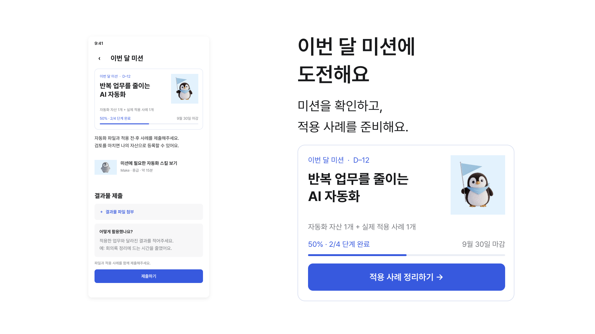
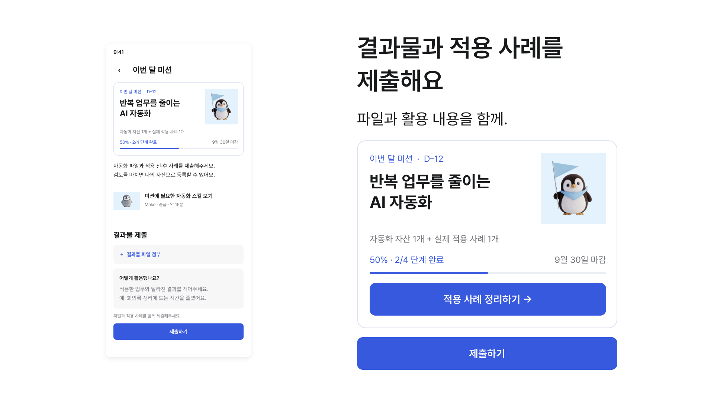
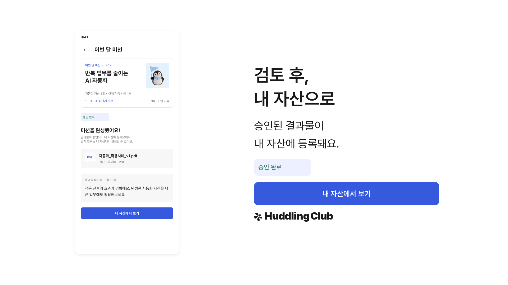
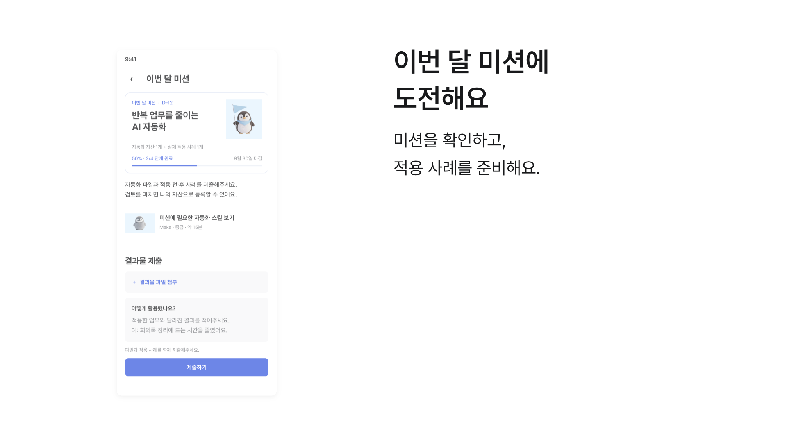

# 스냅보드 v1 — A · 따라가기

승인 A와 읽는 시간 규칙은 APPROVALS.md에 기록했다. 아래는 정지 렌더이며, 승인 B 전에는 본 영상 타임라인을 만들지 않는다.
출력 크기·폰트·배경·부품 근거는 VALUES.md. 실제 src 화면·HTML·이미지·폰트를 사용했다.

## A1 · 미션 확인 — 0~5초 구간의 정착 모습

미션 화면 옆에 원본 미션 카드. apply-case 버튼은 카드 안의 원본을 재사용한다. 헤드라인과 보조 글자만 별도 영상 텍스트다.

## A2 · 제출 — 5~10초 구간의 정착 모습

같은 미션 화면의 제출 양식과 실제 submit 상태의 버튼을 보여준다. 작성 완료·로딩 등 src에 없는 상태는 추가하지 않았다.

## A3 · 검토 후 승인 — 10~15초 구간의 정착 모습

실제 승인 화면·배지·view-assets 버튼·로고를 사용했다. “검토 후”를 명시해 즉시 승인이라는 오해를 막는다.

## 등장 중간 포즈 — 실제 재생 검증 아님

폰 등장 시간의 중간 지점만 계산한 설명용 포즈다. 폰 정착 전에 부품은 아직 보이지 않는다. 실제 감속·시차는 영상 단계에서 확인한다.

## 검수 범위와 제한

- 세 정착 화면의 lint·runtime·layout 검사에서 오류가 없다. 관련 원본 보고서는 snapboard 각 폴더의 .hyperframes/artifacts/checks 아래에 있다.
- A1/A2의 Hyperframes 전체 check는 원본 회색 글자의 대비 지적으로 실패를 반환했다. 원본 폰트 12px를 기준으로 일반 글자로 분류하지만 실제 wrapper 표시 배율은 2이므로 최종 글자 크기는 24px다.
- 검사기 contrast-audit.browser.js의 fontSize 기반 분류를 확인하고, 실제 표시 크기를 반영해 대비를 재계산했다. 해당 회색 글자 4.48:1은 큰 글자의 기준 3:1을 충족한다. 원본 색을 바꾸거나 오류 보고서를 지우지 않았다.
- 재계산 근거와 프레임별 결과는 `snapboard/static-check-summary.json`에 보존했다. PNG 내부 UI의 모든 글자를 OCR로 검증한 것은 아니다.
- still 메타데이터 길이 때문에 발생한 읽는 시간 경고는 본 영상 판정으로 사용하지 않는다. 작은 UI 글자는 맥락이며 핵심 문구는 video.md의 영상 텍스트 크기로 별도 제공한다.
- 레퍼런스의 상승·감속·정착 후 등장·시차는 정적 이미지로 실제 통과 처리하지 않는다. R-01~04 실제 반영률은 아직 미검증이다.

다음 단계: 사용자가 이 스냅보드를 승인하면 같은 자산·구도로 15초 영상을 구현한다.
